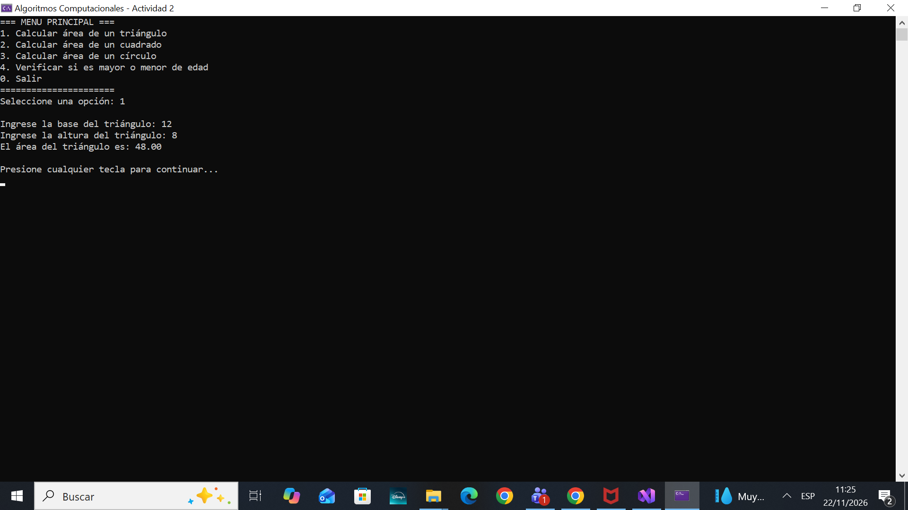
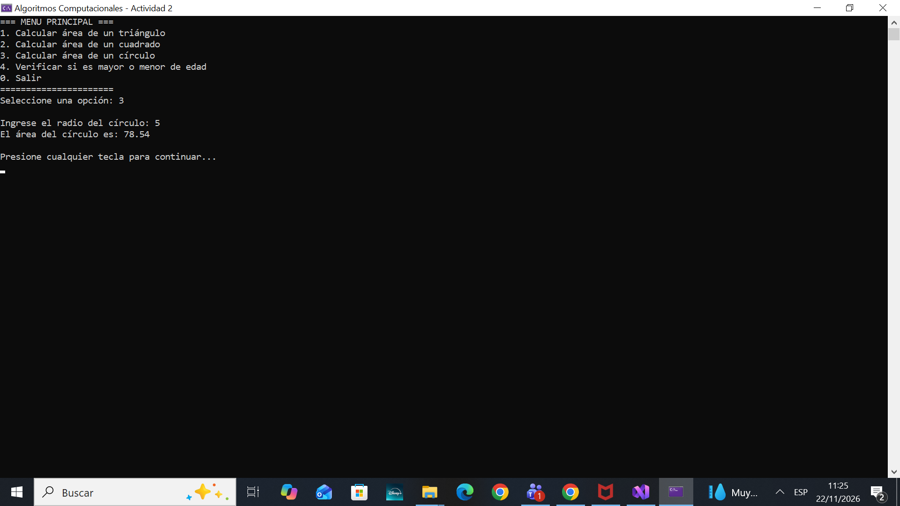

# Actividad 2 - Control de Flujo y Métodos en C#

## Autor(es) y Matrícula
* Yohaeyelis Angela Sanchez Castillo — `26-EISN-2-051`
* Yohan Javier De Gracia Torres — `26-EISN-2-009`
* José Rafael Jiron Santana — `26-EISN-2-013`

## Descripción Breve
Aplicación de consola desarrollada en C# que utiliza estructuras de control de flujo (`while`, `switch`) y métodos parametrizados con retorno para calcular áreas geométricas (triángulo, cuadrado y círculo) y determinar si una persona es mayor o menor de edad.

## Datos de Entrada
* Opción del menú principal (`0` a `4`).
* Base y altura del triángulo (números positivos).
* Lado del cuadrado (número positivo).
* Radio del círculo (número positivo).
* Edad de la persona (número entero mayor o igual a `0`).

## Datos que Procesa
* Cálculo del área del triángulo mediante `(base * altura) / 2`.
* Cálculo del área del cuadrado mediante `lado * lado`.
* Cálculo del área del círculo mediante `π * radio²`.
* Evaluación condicional de la edad (`>= 18` para mayor de edad, `< 18` para menor de edad).
* Validación de entradas numéricas y control de bucle en el menú de consola.

## Datos de Salida
* Resultados numéricos con dos decimales para las áreas de triángulo, cuadrado y círculo.
* Mensaje indicando si la persona es mayor o menor de edad según el valor ingresado.
* Mensajes de aviso ante entradas inválidas y regreso al menú principal.

## Capturas de Pantalla (Distintos Escenarios)

### Escenario 1: Cálculo del área de un triángulo

### Escenario 2: Cálculo del área de un cuadrado

### Escenario 3: Cálculo del área de un círculo

### Escenario 4: Verificación de mayor de edad

### Escenario 5: Verificación de menor de edad
